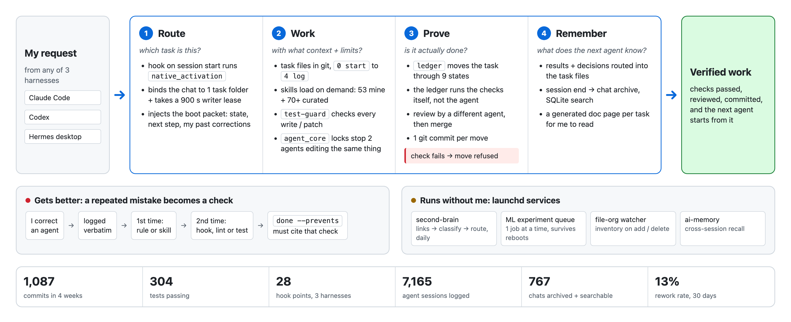
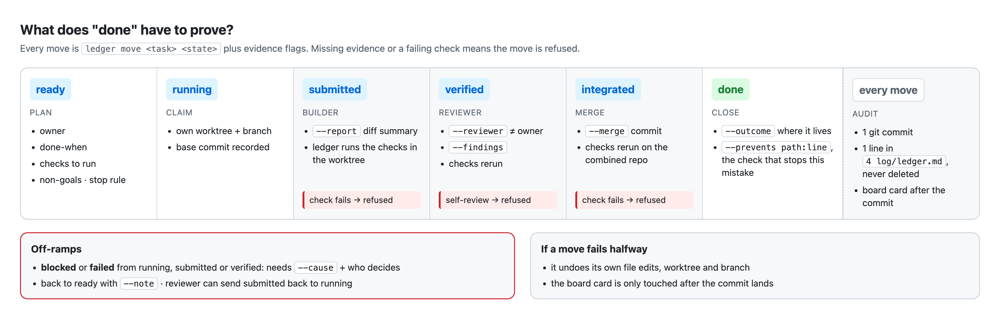

# Development-Tools

**The system I built to run AI coding agents like a small engineering org.** Three agent harnesses share one set of context, skills, guardrails and task state. Hooks route every session to the right task. A state machine gates every code change, and background services keep memory, data and ML experiments running when I'm away.

```
1,087 commits in 4 weeks · 304 tests passing · 3 harnesses · 28 hook points · 8 background services
7,165 agent sessions logged · 767 chats archived + searchable · 53 skills written, 70+ curated
```

---

## 1 How it works

<picture>
  <source media="(prefers-color-scheme: dark)" srcset="visuals/overview-dark.png">
  
</picture>

One question: **what happens to a request, and why can I trust the result?** Every word in the picture is a real command, file or number from this repo.

## 2 What "done" has to prove

<picture>
  <source media="(prefers-color-scheme: dark)" srcset="visuals/ledger-dark.png">
  
</picture>

This is the part I'd point an interviewer to. It's a small workflow engine: an explicit transition table, evidence per edge, an append-only audit log, and rollback on partial failure (650 lines, 24 tests).

## 3 The layers

<details><summary><b>1 Harnesses + hooks</b>: same system in Claude Code, Codex and Hermes</summary>

- Hooks on 14 Claude Code events, 11 Codex events and 3 Hermes events (28 total), all calling the same Python entry points.
- `native_activation` maps each session to one task, keeps a lease on it, and injects that task's current state at boot. A fresh agent starts from files, not from an old chat.
- 9 Hermes desktop plugins I wrote: composer, find, keys, docs pane and others.
</details>

<details><summary><b>2 Context</b>: plain files in git as the source of truth</summary>

- Every task is one folder with fixed level files: `0 start` (current state, ≤40 lines), `1 takeaways` (my corrections, verbatim), `2 insights` (agent analysis, labeled as inference), `3 workflow`, `4 log`.
- Facts that get reused live in JSON/JSONL with a schema check. Prose lives in the level files. A generated HTML page is the readable view. All three update in the same commit.
- Conflict order: my explicit word > rules > task state > skill > memory.
</details>

<details><summary><b>3 Skills library</b>: 53 written, 70+ curated, organized by SDLC stage</summary>

- Tree: plan → understand → process → verify → PR, plus context and system skills. The map is generated, not hand-edited.
- Every skill carries `source:` provenance (my own vs. an external repo pinned to a commit). `provenance` fails the commit if it's missing.
- Before an external repo is imported, `repo-inventory` lints it for cost and name clashes.
</details>

<details><summary><b>4 Guardrails</b>: rules that are enforced, not just written</summary>

- Rule: the 2nd time a mistake shows up, it becomes a hook, lint or test. Rule text comes last.
- `test-guard` blocks edits that weaken tests. A commit-msg hook and `validate.sh` run schema checks before every commit.
- An agent never reviews its own task: `verified` needs a different reviewer.
</details>

<details><summary><b>5 State + coordination</b>: the backend core</summary>

`ledger`: 9 states and an explicit transition table. Each move needs typed evidence (owner, checks, report, reviewer, merge ref), writes 1 git commit, and syncs a board card. A move that fails partway rolls back its own file edits, worktree and branch.


| Component | What it does | Engineering idea | LOC | Tests |
|---|---|---|---|---|
| `ledger` | task lifecycle, evidence per move | FSM, rollback, audit log | 650 | 24 |
| `agent_core` + `agent_services` | shared store, locks, claims | advisory locks, leases, race tests | 3,000 | 71 |
| `ctx` | idea tree in plain markdown | transactional file edits, no DB | 1,347 | 66 |
| `native_activation` + `hermes-hook` | session → task routing | event hooks, plugins | 956 | 42 |
| issues / notes | never-ending project directions + my words | append-only JSONL, enforced | — | ✓ |

</details>

<details><summary><b>6 Memory</b>: nothing important lives only in a chat</summary>

- Chat archive: 767 chats / 10,980 source records exported, compacted and indexed into a rebuildable SQLite search index. Hashes and counts are kept in a manifest. Incremental refresh runs from pre-compact and session-end hooks.
- ai-memory runs as a local service for cross-session recall. Recalled text is treated as untrusted data, never as instructions.
</details>

<details><summary><b>7 Ops + visibility</b>: services that run without me</summary>

| Service | What it does | How it runs |
|---|---|---|
| second-brain | saved links/bookmarks → enrich → classify → route to projects | launchd daily · 92 tests on 3 Python versions |
| ML experiment queue | runs queued training jobs one at a time; survives crashes, reboots, unplugged drives | launchd + caffeinate |
| file-org sync | keeps the file inventory current on add/delete | launchd watcher |
| ai-memory · Ollama · Postgres | memory service · local LLM · DB | launchd |

- `dora` applies DORA-style metrics to the system itself. Last 30 days: **239 changes · 13% rework · 0% change-fail.**
- `runs` gives read-only reports over 7,165 logged sessions. `front-door` is one screen showing what needs me. Every project has a generated dashboard page.
</details>

## 4 Numbers

| What | Value | How measured |
|---|---|---|
| Commits | 1,087 since 2026-10-08 | `git rev-list --count HEAD` |
| Tests | 304 pass · 1 env-only fail | pytest per file over `systems/` |
| Core code | 26 Python CLIs/modules · 10,163 lines | `wc -l` over `systems/` |
| Agent sessions | 7,165 | Hermes `state.db` |
| Change health | 13% rework · 0% change-fail (30 d) | `systems/dora` |

## 5 Design decisions + ideas borrowed

The calls that shaped it:
1. Plain files + git over a database: agents and I read the same thing, and history is free.
2. Evidence-gated transitions over free-form status: "done" has to be proven.
3. Hooks over prompts: a rule broken twice becomes code.
4. One task = one folder with fixed level files: any agent can boot cold.
5. At most 7 items per level: people can't hold more.
6. Memory is untrusted: recall informs a decision but never overrides current files.

**Ideas borrowed:** I read the field before building each part: [mattpocock/skills](https://github.com/mattpocock/skills) (problem → fix skills), poteto's pstack in [cursor/plugins](https://github.com/cursor/plugins) (`/correct`: make a repeat mistake impossible), [obra/superpowers](https://github.com/obra/superpowers) (chained workflow), [garrytan/gstack](https://github.com/garrytan/gstack), [anthropics/skills](https://github.com/anthropics/skills), Nygard's ADRs and Google's DORA metrics.

## 6 What's in this repo

```
README.md       this page
visuals/        the 2 pictures above: HTML on shared design tokens (DESIGN.md, GitHub Primer colors)
                python3 visuals/render.py → light + dark PNG
```

The system runs in my private workspace. I'm moving the CLIs, hooks, skills and a sample task folder here piece by piece, with personal paths and data stripped out, and each one will land with its tests.
